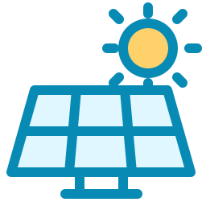

# PV Manager

Home-Assistant-Karte für PV, Netz, Haus und Batteriespeicher. Die komplette Oberfläche verwendet das lokal gebündelte **HA UI Kit 1.9.1**. Keine CDN-Abhängigkeit, keine Cloud und keine zusätzliche Diagrammkarte nötig.

## Erste Version 1.0.0

- Animierter Energiefluss wie in der Referenz: PV oben, Netz links, Haus rechts, Batterie unten; Ladezustand und eindeutige Bezugs-/Laderichtung.
- Tages-, Wochen-, Monats- und Jahresverlauf mit Datumsnavigation.
- Leistung als Linien (Tag 5 Minuten, Woche 1 Stunde, Monat 6 Stunden, Jahr 1 Tag), Batterie-Ladezustand als eigene Linie, Energieerträge als Balken (Tag Stunden, Woche/Monat Tage, Jahr Monate).
- Einzelwerte mit Maus, Finger oder Pfeiltasten; Anzeige oberhalb des Diagramms.
- Suchbare Sensorzuordnung und anpassbare Vorzeichen. Batterie und kWh-Zähler optional. Mehrere unabhängige Karten über `card_id`.
- Zentrale Einstellungen pro Karte, Änderungen durch HA-Administratoren. Die historischen Abfragen laufen mit den HA-Berechtigungen des betrachtenden Nutzers.

## Installation mit HACS

1. HACS → Benutzerdefinierte Repositories → `https://github.com/v9h45n47mh-lab/pv-manager`, Kategorie **Integration**.
2. **PV Manager** herunterladen und Home Assistant neu starten.
3. Einstellungen → Geräte & Dienste → Integration hinzufügen → **PV Manager**.
4. Dashboard bearbeiten → Karte hinzufügen → **PV Manager**. Falls die Karte noch fehlt, Browser neu laden.
5. Zahnrad der Karte öffnen, Sensoren und Vorzeichen prüfen und speichern.

Die Kartenressource wird automatisch registriert. Keine manuelle Ressourcenregistrierung erforderlich.

## Manuelle Installation

`pv-manager-manual.zip` vom Release herunterladen und im Home-Assistant-Konfigurationsverzeichnis entpacken. Danach muss `custom_components/pv_manager/manifest.json` vorhanden sein. Neu starten und ab Schritt 3 fortfahren. `pv-manager.zip` ist das HACS-Paket und enthält den Inhalt des Integrationsordners ohne äußere Ordnerstruktur.

```yaml
type: custom:pv-manager-card
card_id: pv_hauptanlage
title: PV-Anlage
```

Für eine zweite Karte eine eigene `card_id` verwenden. Diese darf Buchstaben, Ziffern, Bindestriche und Unterstriche enthalten. Die im Zahnrad gespeicherte Konfiguration hat Vorrang vor YAML-Vorschlägen.

## Sensoren

| Verwendung | Sofar-Vorschlag | Erwartete Einheit |
| --- | --- | --- |
| PV | `sensor.inverter_power` | W / kW / MW |
| Netz | `sensor.inverter_grid_power` | W / kW / MW |
| Haus | `sensor.inverter_load_power` | W / kW / MW |
| Batterie | `sensor.inverter_battery_power` | W / kW / MW |
| Ladezustand | `sensor.inverter_battery` | % |
| Energiezähler | In den Einstellungen zuordnen | Wh / kWh / MWh |

Standard: positiver Netzwert = **Bezug**, positiver Batteriewert = **Entladen**. Beide Regeln sind umkehrbar. Bitte anhand realer Einspeisung/Ladung prüfen. Energieflussverbindungen sind rechnerische Zuordnungen aus den Gesamtleistungen mit Priorität PV → Haus → Batterie → Netz. Die Bilanz kann durch Messzeitpunkte, Wechselrichterverluste oder falsche Zuordnung abweichen; eine größere Abweichung wird angezeigt. Einzelne Herkunftsflüsse werden nicht separat gemessen.

## Historische Daten

Die Karte nutzt die Home-Assistant-Recorder-Statistik. Leistung und Ladezustand benötigen üblicherweise `state_class: measurement`. Energiezähler benötigen `state_class: total` oder `total_increasing` mit korrekten Reset-Metadaten. Für Energie nur Zähler auswählen, die diese Statistik tatsächlich bereitstellen; reine Leistungssensoren werden nicht als kWh interpretiert.

Es werden vorhandene Daten verwendet. Die Karte erzeugt weder Messhistorie vor der Installation noch fehlende Langzeitstatistiken. Leere Intervalle bleiben leer. Die 5-Minuten-Statistik ist durch die Recorder-Aufbewahrung begrenzt; Tagesansichten, die älter als sieben Tage sind, fragen Stundenwerte ab. Bei kürzerer Aufbewahrung können auch neuere Tage Lücken haben. Energiesummen zeigen die erfassten Intervalle und können bei Lücken sowie im laufenden Intervall unvollständig sein. Es gibt keine Kosten-, Autarkie- oder Eigenverbrauchsberechnung aus unvollständigen Zählern.

Kalendergrenzen verwenden die Home-Assistant-Zeitzone einschließlich Sommerzeit. Leistungsmittel werden nach vorhandener Intervalldauer gewichtet. Monatsdarstellungen verwenden 6-Stunden-Intervalle ab lokalem Monatsbeginn; Energiebalken verwenden lokale Kalendertage beziehungsweise Monate.

## Entwicklung

```sh
npm install
npm run build
npm run check
npm test
npx playwright install chromium
npm run test:browser
npm run package
```

`tests/demo.html` ist eine lokale Vorschau mit klaren Beispieldaten. Die produktive Karte enthält keine Demowerte. Die festen UI-Dateien samt Lizenz und Prüfsummen liegen unter `frontend/family-ui/1.9.1`. Änderungen an gemeinsamem Aussehen erfolgen im [HA UI Kit](https://github.com/v9h45n47mh-lab/ha-ui-kit).

## PV-Manager-Icon (nächstes Release)



Das eigene Icon wird mit dem nächsten Release lokal unter `custom_components/pv_manager/brand/` sowie im Repository für HACS mitgeliefert. Helle und dunkle Varianten liegen in 256 und 512 Pixeln mit transparentem Hintergrund vor. Die Darstellung im HACS-Katalog hängt von dessen lokaler Brand-Unterstützung ab.

Die editierbare Quelle ist `brand/pv.svg` innerhalb des Integrationsordners. Für eine erneute Rasterung steht `scripts/build_icons.cjs` bereit (Entwicklungswerkzeug: `npm install --no-save sharp`, danach `node scripts/build_icons.cjs`). Auf Home Assistant werden keine weiteren Pakete benötigt.
